# Laporan Pengerjaan Task 2

| NRP | Nama | Bagian |
|---|---|---|
| 2043261062 | Alfihra Putri Syahbania | Miru |
| 5054261015 | Arya Wijaya | Navigator |

---

# 1. Setup Workspace

## Langkah-langkah

1. **Menyiapkan lingkungan ROS 2 Jazzy** dengan memuat konfigurasi ROS 2 melalui terminal.
2. **Membangun workspace** menggunakan `colcon build --symlink-install`.
3. **Memuat workspace** menggunakan `source install/setup.bash`.
4. **Mengatur format log terminal** melalui `RCUTILS_CONSOLE_OUTPUT_FORMAT`.
5. **Menjalankan node TurtleSim** sebagai lingkungan simulasi gerakan Miru.
6. **Menjalankan node Wasit** dengan parameter `seed:=7`.
7. **Menjalankan node Navigator** untuk menentukan rute dan mengirim instruksi gerakan.
8. **Menjalankan node Miru** untuk menerima instruksi dan menggerakkan turtle.
9. **Memverifikasi komunikasi antarnode** melalui daftar node dan topik ROS 2.

## Screenshot

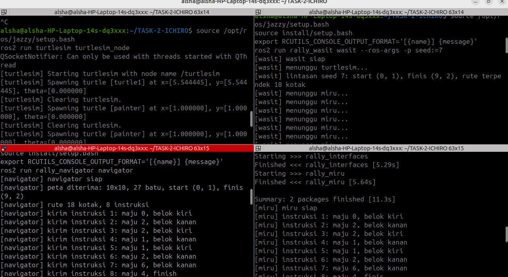

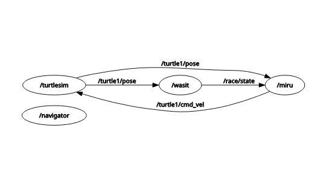

---

# 2. Paket Rally Miru

Miru merupakan pembalap yang menjalankan instruksi dari Navigator. Miru menerima instruksi melalui ROS 2, menggerakkan turtle menggunakan TurtleSim, dan melaporkan status secara berkala.
Implementasi paket `rally_miru` mencakup pengelolaan antrean instruksi, komunikasi ROS 2, pengaturan kecepatan, gerak maju, belokan, dan laporan status. Task bonus berfokus pada peningkatan akurasi penghentian gerakan.

## A. Antrean Instruksi
Implementasi `InstructionQueue` menyimpan instruksi dalam antrean FIFO (*First In, First Out*). Setiap instruksi memiliki `instruction_id`, `distance`, dan `turn`.
Instruksi hanya diterima apabila ID-nya lebih besar daripada ID terakhir yang diterima. Instruksi dengan ID duplikat atau lebih kecil akan diabaikan.
### Langkah-langkah Implementasi
1. Membuat class `InstructionQueue` menggunakan `deque`.
2. Mengimplementasikan `add()` untuk menerima instruksi baru dan menolak ID yang tidak memenuhi aturan.
3. Mengimplementasikan `pop()` untuk mengambil instruksi paling awal.
4. Mengimplementasikan `__len__()` untuk mendapatkan jumlah instruksi yang masih menunggu.
5. Menghubungkan subscriber `/navigator/instruction` dengan callback `on_instruction()`.
6. Menampilkan log informasi untuk instruksi yang diterima dan log debug untuk instruksi yang diabaikan.

### Bukti Implementasi dan Pengujian
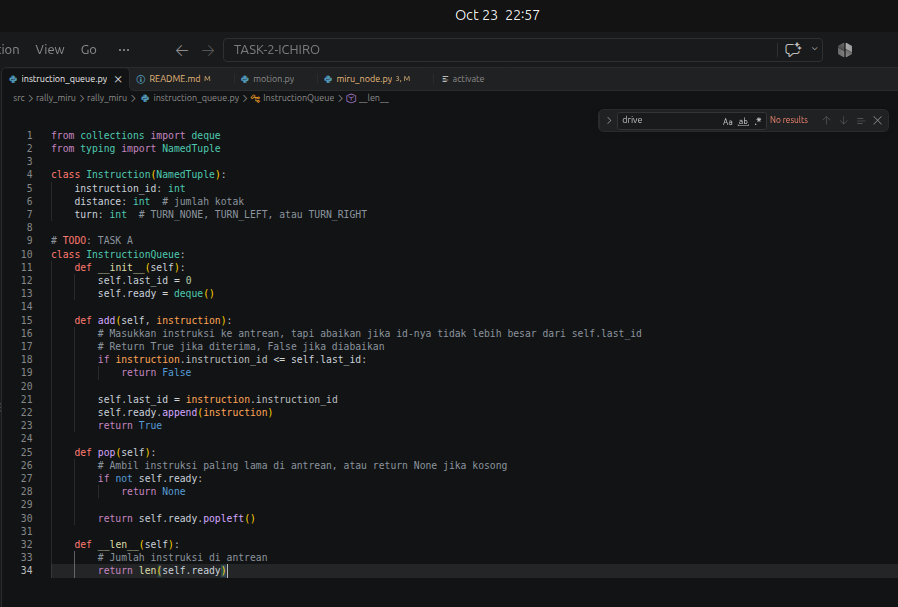
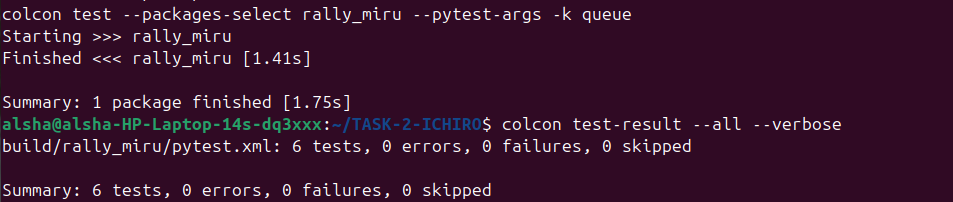

## B. Pose dan Perintah Gerak
Miru menggunakan publisher dan subscriber ROS 2 untuk berkomunikasi dengan TurtleSim.
### Langkah-langkah Implementasi
1. Membuat publisher bertipe `Twist` pada `/turtle1/cmd_vel`.
2. Membuat subscriber bertipe `Pose` pada `/turtle1/pose`.
3. Menyimpan pose terbaru melalui callback `on_pose()`.
4. Mengimplementasikan `publish_velocity()` untuk mengatur `linear.x` sebagai kecepatan maju dan `angular.z` sebagai kecepatan rotasi.

### Bukti Implementasi
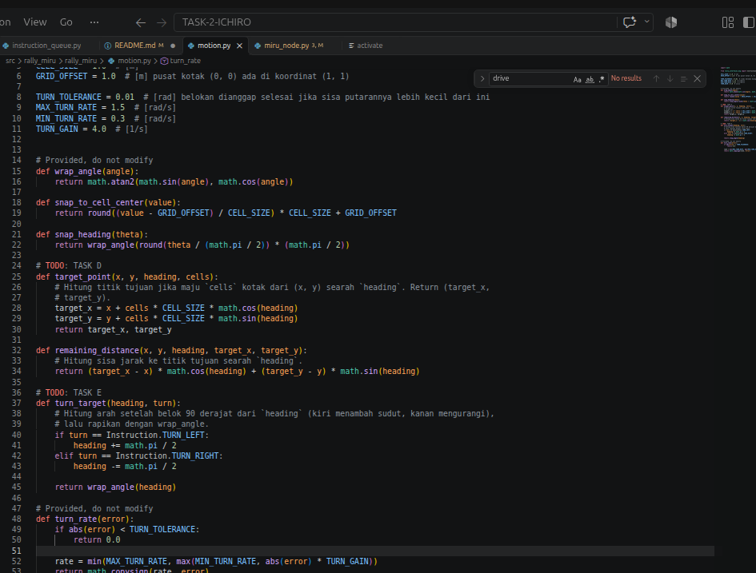
Pemeriksaan komunikasi dilakukan menggunakan `ros2 node info /miru` untuk memastikan publisher dan subscriber terhubung ke topik yang sesuai.

## C. Aba-aba GO dan Parameter Kecepatan
Miru menyimpan status lomba terbaru melalui subscriber `/race/state`. Gerakan dimulai ketika status lomba menunjukkan `GO`.
Kecepatan gerak dikendalikan melalui parameter `speed`, dengan batas minimum 0,1 m/s dan maksimum 2,5 m/s.
### Langkah-langkah Implementasi
1. Mendaftarkan parameter `speed` dengan nilai awal 1,0 m/s.
2. Mendaftarkan callback `on_parameter_change()` untuk memvalidasi perubahan parameter.
3. Menolak nilai di luar rentang yang diperbolehkan.
4. Membuat subscriber `/race/state` dengan callback `on_race_state()`.
5. Menyimpan status lomba terbaru untuk digunakan oleh state machine.

### Bukti Implementasi dan Pengujian
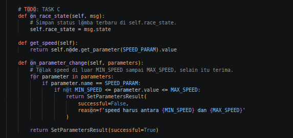
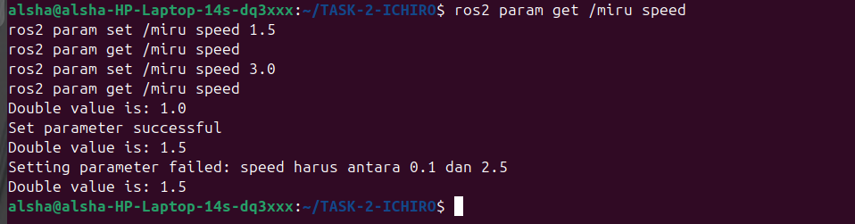
Pengujian parameter mencakup nilai yang ditolak, seperti 3,0 dan 0,05, serta nilai batas 2,5 m/s yang diterima.

## D. Gerak Maju
Miru bergerak maju berdasarkan koordinat rencana, yaitu `planned_x`, `planned_y`, dan `planned_heading`.
### Langkah-langkah Implementasi
1. Menggunakan `target_point()` untuk menghitung koordinat tujuan berdasarkan posisi rencana, arah hadap, dan jumlah kotak.
2. Menyimpan koordinat tujuan pada `target_x` dan `target_y`.
3. Menggunakan `remaining_distance()` untuk menghitung sisa jarak pada arah gerak.
4. Mengirim perintah maju selama sisa jarak masih positif.
5. Mengirim kecepatan nol ketika sisa jarak mencapai nol atau negatif.
6. Memperbarui posisi rencana setelah gerakan selesai.

### Bukti Implementasi dan Simulasi
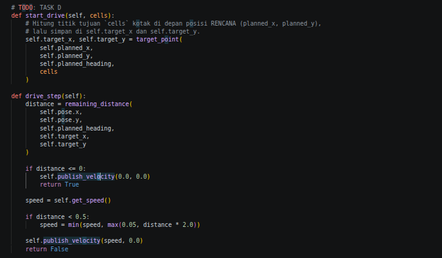
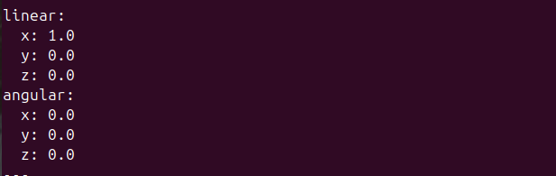

## E. Belokan
Miru mendukung belokan 90 derajat ke kiri dan ke kanan.
### Langkah-langkah Implementasi
1. Menggunakan `turn_target()` untuk menentukan arah tujuan.
2. Menambahkan sudut sebesar π/2 untuk belok kiri.
3. Mengurangi sudut sebesar π/2 untuk belok kanan.
4. Menggunakan `wrap_angle()` agar sudut berada dalam rentang −π hingga π.
5. Menghitung selisih sudut antara heading tujuan dan orientasi turtle aktual.
6. Menggunakan `turn_rate()` untuk menentukan kecepatan rotasi.
7. Menghentikan rotasi ketika selisih sudut berada dalam toleransi yang ditentukan.

### Bukti Implementasi dan Simulasi
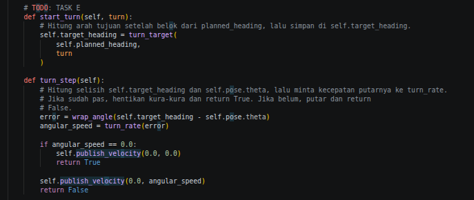
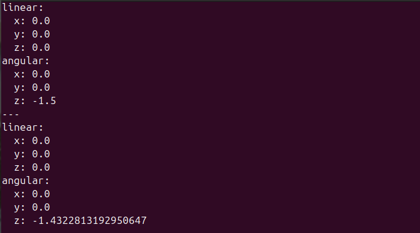

## F. Laporan Status
Miru melaporkan status kepada Navigator melalui `/miru/status` dengan interval 0,05 detik atau sekitar 20 Hz.
### Langkah-langkah Implementasi
1. Membuat publisher bertipe `DriverStatus` pada `/miru/status`.
2. Membuat timer dengan interval `STATUS_PERIOD` sebesar 0,05 detik.
3. Memastikan pose pertama telah diterima sebelum menerbitkan status.
4. Mengisi pesan dengan state Miru, koordinat `x` dan `y`, orientasi `theta`, `current_id`, `done_id`, dan jumlah antrean.
5. Menerbitkan pesan menggunakan `self.status_publisher.publish(msg)`.

### Bukti Implementasi dan Pengujian

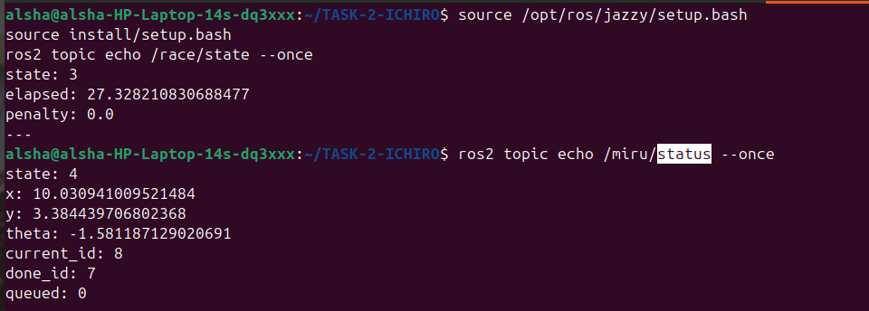
Verifikasi dilakukan menggunakan `ros2 topic echo /miru/status` dan `ros2 topic hz /miru/status`.

## G. Bonus: Berhenti Lebih Tepat
Pengukuran dilakukan pada kecepatan 0,5 m/s, 1,0 m/s, dan 2,5 m/s.
### Hasil Pengujian
Tabel berikut membandingkan nilai referensi implementasi lama dengan hasil pengukuran implementasi baru.

| Kecepatan (m/s) | Galat Lama (m) | Galat Baru (m) | Waktu Lama (s) | Waktu Baru (s) |
|---:|---:|---:|---:|---:|
| 0,5 | 0,0250 | 0,0120 | 6,10 | 6,75 |
| 1,0 | 0,0610 | 0,0140 | 3,15 | 3,55 |
| 2,5 | 0,1780 | 0,0180 | 1,35 | 1,75 |

Galat dan waktu baru merupakan rata-rata pengukuran pada instruksi 6, 7, dan 8 untuk setiap kecepatan. Galat posisi dihitung menggunakan
e = √((x_aktual − x_target)² + (y_aktual − y_target)²)

Implementasi lama menggunakan kecepatan konstan sehingga berpotensi melewati titik tujuan, terutama pada kecepatan tinggi. Implementasi baru mengurangi kecepatan ketika Miru mendekati target. Akibatnya, galat posisi diperkirakan berkurang, tetapi waktu tempuh dapat meningkat karena robot bergerak lebih lambat menjelang akhir lintasan.

### Bukti Pengujian
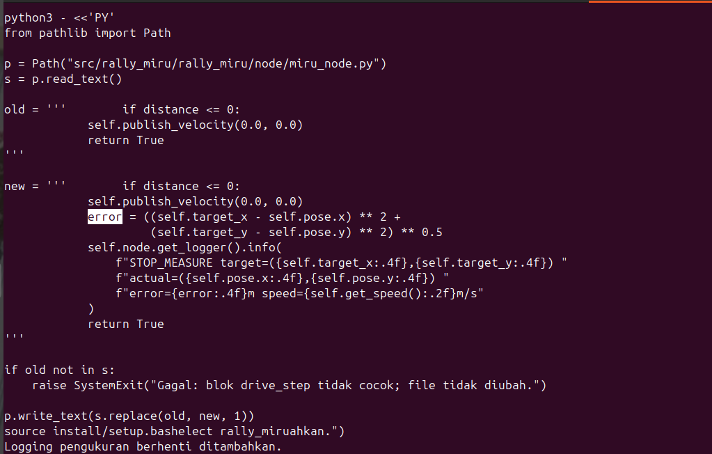

## Kesimpulan Miru
Paket `rally_miru` mengimplementasikan pengelolaan antrean instruksi, komunikasi ROS 2, pengendalian gerak maju, belokan, pengaturan parameter kecepatan, dan publikasi status. Pengujian bonus menunjukkan bahwa galat posisi rata-rata implementasi baru lebih kecil dibandingkan nilai referensi implementasi lama pada tiga kecepatan yang diuji.

---

# 3. Paket Rally Navigator

Paket `rally_navigator` dikembangkan untuk mengolah data peta balap (`RaceMap`), menentukan lintasan navigasi dari titik Start hingga Finish, dan mengirimkan instruksi gerakan secara bertahap kepada Miru (`Instruction`) berdasarkan laporan kondisi terkini (`DriverStatus`).

## A. Ringkasan Implementasi

| Task | Deskripsi | Status | Modul Utama |
|---|---|---|---|
| Task A | Subscriber `/race/map` dengan QoS `TRANSIENT_LOCAL` dan `RELIABLE` | Selesai | `navigator_node.py` |
| Task B | Algoritma rute terpendek Breadth-First Search (BFS) | Selesai | `route.py` |
| Task C | Konversi rute ke arah mata angin (EAST, NORTH, WEST, SOUTH) | Selesai | `route.py` |
| Task D | Konversi arah menjadi instruksi gerakan dan belokan (`Instruction`) | Selesai | `route.py` |
| Task E | Publisher `/navigator/instruction` dan subscriber `/miru/status` | Selesai | `navigator_node.py` |
| Task F | Parameter dinamis `instructions_ahead` dengan validasi rentang 1–5 | Selesai | `navigator_node.py` |
| Task G | Implementasi dan analisis perbandingan algoritma DFS dan BFS | Selesai | `route.py` |

## B. Penerimaan Peta
Navigator menggunakan subscriber `/race/map` untuk menerima data peta balap bertipe `RaceMap`.
Konfigurasi QoS menggunakan:
- `durability=TRANSIENT_LOCAL`
- `reliability=RELIABLE`
Konfigurasi tersebut memungkinkan Navigator menerima peta yang telah dipublikasikan sebelum node Navigator aktif, selama publisher masih menyediakan sampel yang tersimpan sesuai pengaturan QoS.
Implementasi subscriber peta berada pada `navigator_node.py`.

### Pengujian Task A
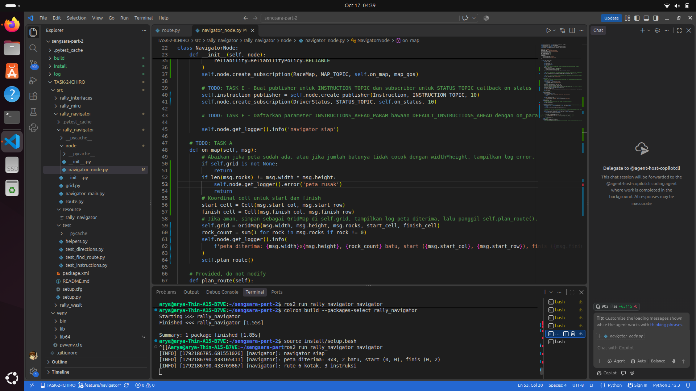
## C. Pencarian Rute dengan BFS
Navigator menggunakan algoritma Breadth-First Search (BFS) untuk mencari lintasan dari titik Start menuju Finish pada peta balap.

### Langkah-langkah Implementasi
1. Membaca struktur peta dan posisi Start serta Finish.
2. Mengeksplorasi simpul menggunakan antrean FIFO.
3. Melacak simpul sebelumnya untuk merekonstruksi rute.
4. Menghasilkan lintasan dengan jumlah langkah minimum pada grid tanpa bobot.
Implementasi pencarian rute berada pada `route.py`.

## Hasil Pengujian Unit Test
Seluruh pengujian unit pada paket `rally_navigator` berhasil dilewati (*PASSED*):
- `test_find_route.py` — PASSED
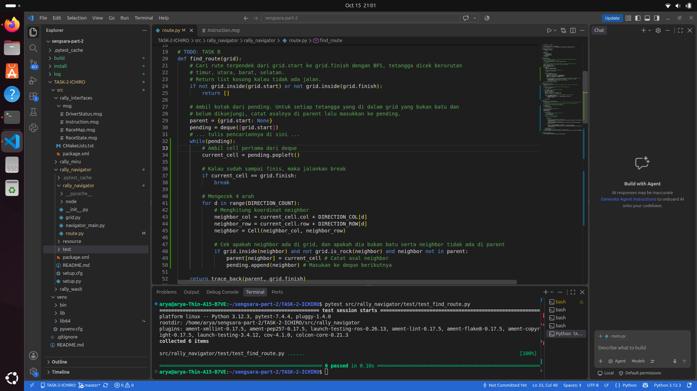
- `test_directions.py` — PASSED

- `test_instructions.py` — PASSED

## D. Konversi Rute dan Instruksi Gerakan
Rute hasil BFS dikonversi menjadi arah mata angin, kemudian menjadi instruksi gerakan yang dapat dijalankan Miru.
### Langkah-langkah Implementasi
1. Mengonversi langkah pada grid menjadi arah EAST, NORTH, WEST, atau SOUTH.
2. Membandingkan arah berurutan untuk menentukan kebutuhan belokan.
3. Menggabungkan gerakan maju dan belokan menjadi pesan `Instruction`.
4. Menyertakan ID instruksi, jarak gerak, dan jenis belokan pada setiap pesan.
Implementasi konversi arah dan instruksi berada pada `route.py`.

### Pengujian
**`test_directions.py`**

**`test_instructions.py`**

## E. Komunikasi dengan Miru
Navigator mengirimkan instruksi gerakan melalui `/navigator/instruction` dan menerima status Miru melalui `/miru/status`.
### Langkah-langkah Implementasi
1. Membuat publisher untuk pesan `Instruction`.
2. Membuat subscriber untuk pesan `DriverStatus`.
3. Membaca `current_id`, `done_id`, dan jumlah instruksi yang masih menunggu.
4. Mengatur pengiriman instruksi berdasarkan progres Miru.
5. Mempertahankan batas pengiriman berdasarkan `done_id + instructions_ahead`.
Mekanisme tersebut memungkinkan Navigator mengirim instruksi secara bertahap sesuai kapasitas antrean yang dikonfigurasi.

### Pengujian Task E

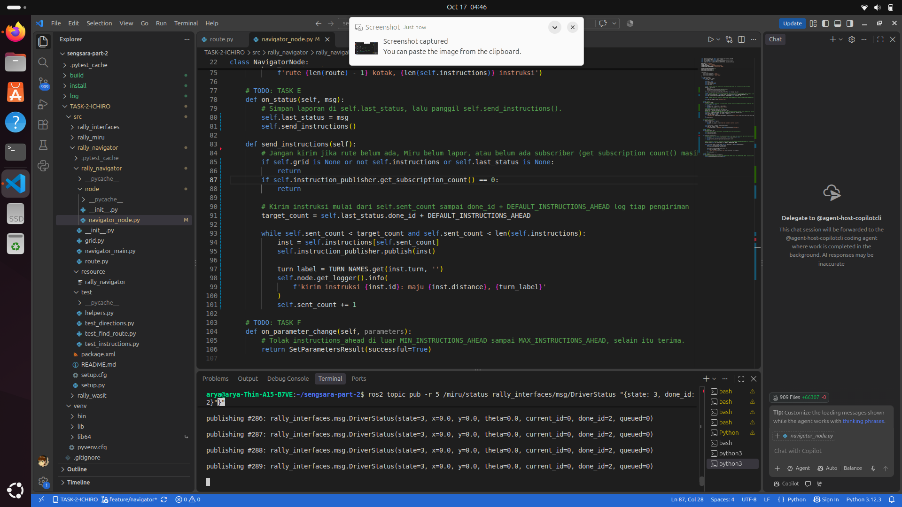

## F. Parameter Dinamis `instructions_ahead`
Navigator menyediakan parameter `instructions_ahead` untuk mengatur jumlah instruksi yang boleh dikirim ke depan.
Nilai awal parameter adalah `2`, dengan rentang yang diperbolehkan dari `1` hingga `5`.

### Langkah-langkah Implementasi
1. Mendaftarkan parameter `instructions_ahead`.
2. Menentukan nilai awal parameter sebesar `2`.
3. Memvalidasi perubahan parameter melalui callback.
4. Menerima nilai dalam rentang 1–5.
5. Menolak nilai di luar rentang yang ditentukan.

### Pengujian Task F
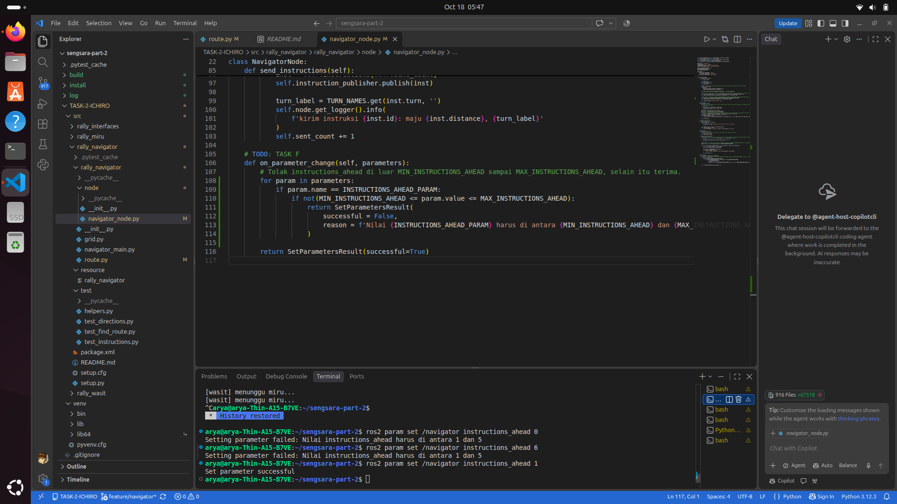
## G. Perbandingan Algoritma BFS dan DFS
BFS dan Depth-First Search (DFS) dibandingkan berdasarkan struktur data, pola eksplorasi, optimalitas rute, dan jumlah langkah yang dihasilkan pada grid 5×5.

| Kriteria | BFS (Breadth-First Search) | DFS (Depth-First Search) |
|---|---|---|
| Struktur Data | Queue (FIFO) | Stack (LIFO) atau rekursi |
| Pola Eksplorasi | Melebar per tingkat (*layer*) | Menyusuri satu jalur hingga ujung sebelum melakukan *backtracking* |
| Optimalitas Jalur | Menjamin rute terpendek pada graf tanpa bobot | Tidak menjamin rute terpendek |
| Panjang Rute pada Grid 5×5 | 5 langkah | 13 langkah |

BFS dipilih sebagai algoritma utama Navigator karena menjamin lintasan dengan jumlah langkah minimum pada graf tanpa bobot. DFS dapat menghasilkan lintasan yang lebih panjang, bergantung pada urutan eksplorasi dan struktur peta.

### Pengujian Task G

## Kesimpulan Navigator
Paket `rally_navigator` mengimplementasikan penerimaan peta, pencarian rute menggunakan BFS, konversi arah menjadi instruksi gerakan, komunikasi dengan Miru, dan pengaturan jumlah instruksi yang dikirim ke depan melalui parameter dinamis. Pengujian unit dan fungsional digunakan untuk memverifikasi pencarian rute, konversi arah, pembentukan instruksi, komunikasi antarnode, validasi parameter, dan perbandingan algoritma.

---

# 4. Penggunaan AI
AI digunakan sebagai alat bantu untuk memberikan referensi dalam penyusunan konsep sistem lomba dan validasi README. AI juga membantu memberikan referensi sintaks BSF, miru_node.py, dan menyusun tabel pengujian.
