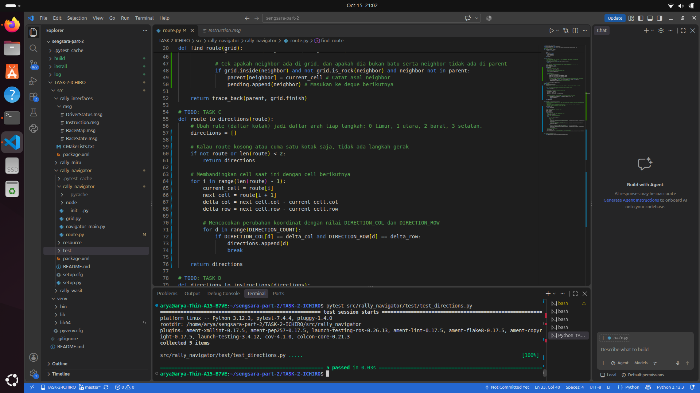
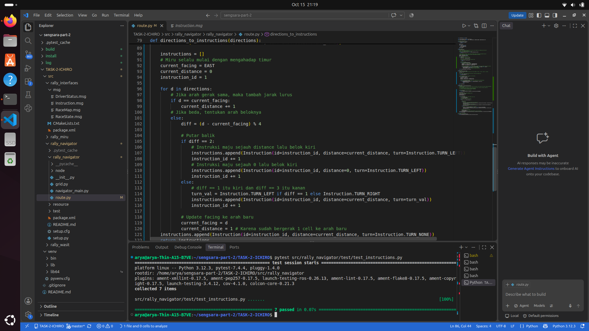
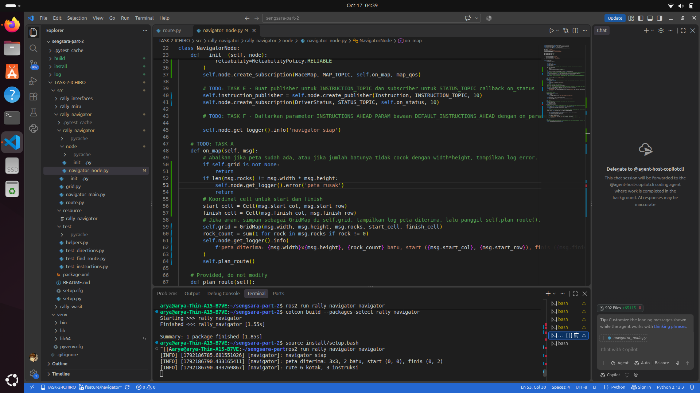
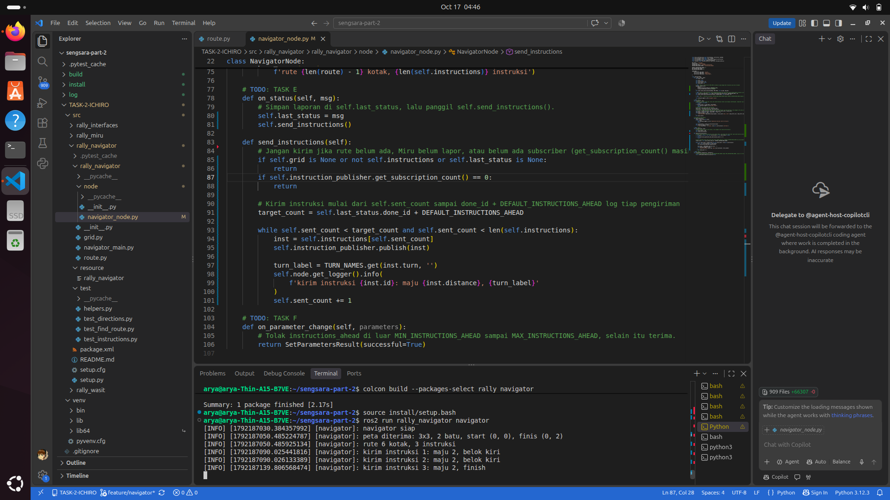
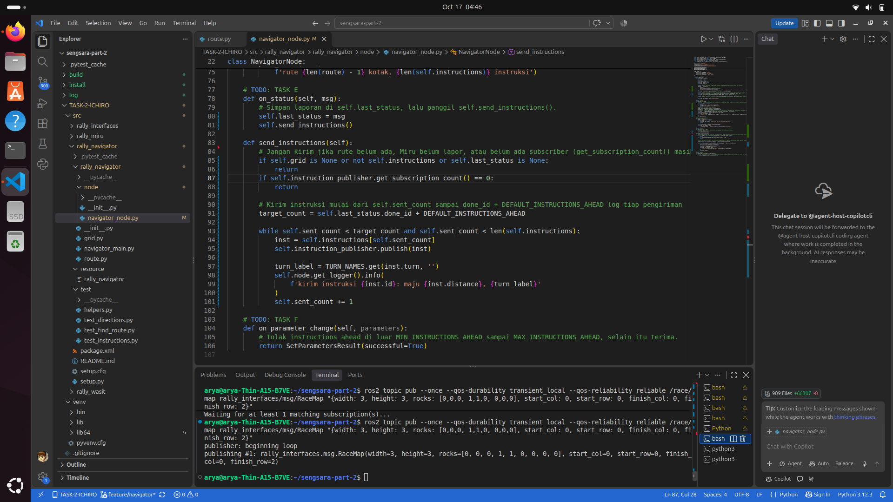
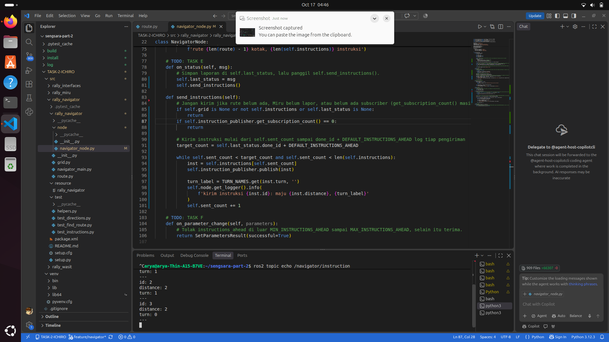
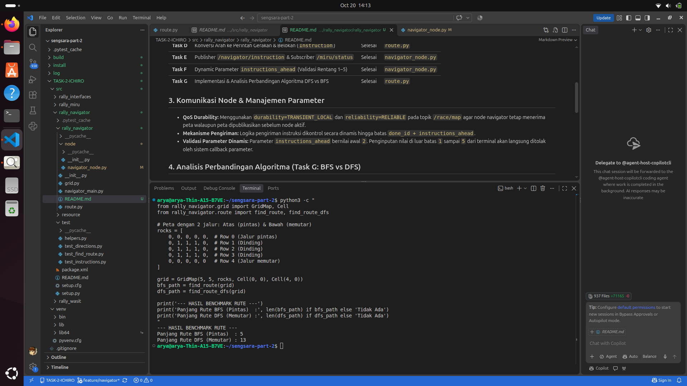

# Laporan Pengerjaan Paket Rally Navigator — Team ICHIRO

## 1. Ringkasan Sistem
Paket `rally_navigator` dikembangkan untuk mengolah data peta balap (`RaceMap`), menentukan lintasan navigasi dari titik Start hingga Finish, dan mengirimkan instruksi gerakan secara bertahap kepada robot Miru (`Instruction`) berdasarkan laporan kondisi terkini (`DriverStatus`).

## 2. Status Implementasi Task

| Task | Deskripsi | Status | Modul Utama |
| :--- | :--- | :---: | :--- |
| **Task A** | Subscriber `/race/map` (QoS `TRANSIENT_LOCAL` & `RELIABLE`) | Selesai | `navigator_node.py` |
| **Task B** | Algoritma Rute Terpendek Breadth-First Search (BFS) | Selesai | `route.py` |
| **Task C** | Konversi Rute ke Arah Mata Angin (EAST, NORTH, WEST, SOUTH) | Selesai | `route.py` |
| **Task D** | Konversi Arah ke Perintah Gerakan & Belokan (`Instruction`) | Selesai | `route.py` |
| **Task E** | Publisher `/navigator/instruction` & Subscriber `/miru/status` | Selesai | `navigator_node.py` |
| **Task F** | Dynamic Parameter `instructions_ahead` (Validasi Rentang 1–5) | Selesai | `navigator_node.py` |
| **Task G** | Implementasi & Analisis Perbandingan Algoritma DFS vs BFS | Selesai | `route.py` |

## 3. Komunikasi Node & Manajemen Parameter
- **QoS Durability:** Menggunakan `durability=TRANSIENT_LOCAL` dan `reliability=RELIABLE` pada topik `/race/map` agar node navigator tetap menerima peta walaupun peta dipublikasikan sebelum node aktif.
- **Mekanisme Pengiriman:** Logika pengiriman instruksi dikontrol secara dinamis hingga batas `done_id + instructions_ahead`.
- **Validasi Parameter Dinamis:** Parameter `instructions_ahead` bernilai awal `2`. Penginputan nilai di luar batas `1` sampai `5` dari terminal akan langsung ditolak oleh sistem callback parameter.

## 4. Analisis Perbandingan Algoritma (Task G: BFS vs DFS)

| Kriteria | BFS (Breadth-First Search) | DFS (Depth-First Search) |
| :--- | :--- | :--- |
| **Struktur Data** | Queue (FIFO) | Stack (LIFO) |
| **Pola Eksplorasi** | Melebar per tingkat (*layer*) | Menyusur satu jalur hingga ujung (*backtracking*) |
| **Optimalitas Jalur** | **Pasti Terpendek** | Rentan Memutar (Sub-optimal) |
| **Panjang Rute (Grid 5x5)**| **5 Langkah** | **13 Langkah** |

*Analisis:* BFS dipilih sebagai algoritma utama navigasi robot karena selalu menjamin rute dengan jumlah langkah minimal, sedangkan DFS cenderung mengambil rute memutar jika menemukan cabang jalan terlebih dahulu.

## 5. Hasil Pengujian Unit Test
Seluruh pengujian unit pada paket `rally_navigator` berhasil dilewati (*PASSED*):
- `test_find_route.py` — PASSED

- `test_directions.py` — PASSED

- `test_instructions.py` — PASSED

- `Task A`

- `Task E`

- `Task F`

- `Task G`
